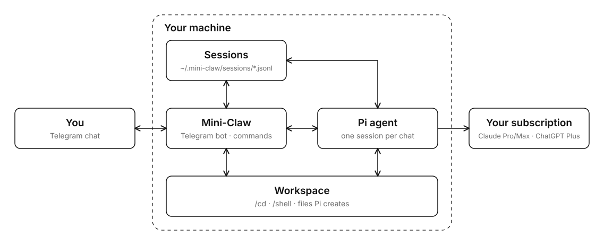

<div align="center">

# Mini-Claw

[](https://github.com/htlin222/mini-claw/stargazers)
[](https://github.com/htlin222/mini-claw/commits/main)
[](LICENSE)
[](https://nodejs.org/)
[](https://www.typescriptlang.org/)

**Lightweight Telegram bot for persistent AI conversations using [Pi coding agent](https://github.com/badlogic/pi-mono).**

A minimalist alternative to [OpenClaw](https://github.com/nicepkg/openclaw) -- use your Claude Pro/Max or ChatGPT Plus subscription directly in Telegram, no API costs.

</div>

---

## Why Mini-Claw?

> You already pay for Claude Pro or ChatGPT Plus. Why pay again for API tokens?
> Mini-Claw lets you chat with your existing subscription through Telegram -- persistent sessions, file attachments, shell access, zero extra cost.

## Features

- **Persistent Sessions** - Conversations are saved and auto-compacted
- **Workspace Navigation** - Change directories with `/cd`, run shell commands with `/shell`
- **Session Management** - Archive, switch, and clean up old sessions
- **File Attachments** - Automatically sends files created by Pi (PDF, images, documents)
- **Rate Limiting** - Prevents message spam (configurable cooldown)
- **Access Control** - Optional allowlist for authorized users
- **Typing Indicators** - Shows activity while AI is processing

## Architecture

<p align="center"><picture>
  <source media="(prefers-color-scheme: dark)" srcset="docs/architecture-dark.svg">
  <source media="(prefers-color-scheme: light)" srcset="docs/architecture.svg">
  
</picture></p>

## Quick Start

### Prerequisites

- Node.js 22+
- pnpm
- [Pi coding agent](https://github.com/badlogic/pi-mono) installed globally

### Installation

```bash
# Clone and install
git clone https://github.com/htlin222/mini-claw
cd mini-claw
pnpm install

# Login to AI provider (Claude or ChatGPT)
pi /login

# Configure bot token
cp .env.example .env
# Edit .env with your TELEGRAM_BOT_TOKEN

# Start the bot
pnpm start
```

### Using Make

```bash
make install    # Install dependencies
make login      # Authenticate with AI provider
make dev        # Development mode (watch)
make start      # Production mode
make test       # Run tests
```

## Bot Commands

| Command        | Description                        |
| -------------- | ---------------------------------- |
| `/start`       | Welcome message                    |
| `/help`        | Show all commands                  |
| `/pwd`         | Show current working directory     |
| `/cd <path>`   | Change working directory           |
| `/home`        | Go to home directory               |
| `/shell <cmd>` | Run shell command directly         |
| `/session`     | List and manage sessions           |
| `/new`         | Start fresh session (archives old) |
| `/status`      | Show bot status                    |

## Configuration

```bash
# Required
TELEGRAM_BOT_TOKEN=your_bot_token

# Optional
MINI_CLAW_WORKSPACE=/path/to/workspace    # Default: ~/mini-claw-workspace
MINI_CLAW_SESSION_DIR=~/.mini-claw/sessions
PI_THINKING_LEVEL=low                      # low | medium | high
ALLOWED_USERS=123456,789012                # Comma-separated user IDs

# Rate limiting & timeouts (milliseconds)
RATE_LIMIT_COOLDOWN_MS=5000                # Default: 5 seconds
PI_TIMEOUT_MS=300000                       # Default: 5 minutes
SHELL_TIMEOUT_MS=60000                     # Default: 60 seconds

# Web search (optional)
BRAVE_API_KEY=your_brave_api_key           # For Pi web search skill
```

## Deployment

### systemd (Linux)

```bash
make install-service
systemctl --user start mini-claw
systemctl --user enable mini-claw
```

### pm2

```bash
pnpm build
pm2 start dist/index.js --name mini-claw
pm2 save
```

### tmux

```bash
tmux new -s mini-claw
pnpm start
# Ctrl+B, D to detach
```

## Development

```bash
# Run in watch mode
pnpm dev

# Type checking
pnpm typecheck

# Run tests
pnpm test

# Run tests with coverage
pnpm test:coverage
```

### Test Coverage

| Module       | Coverage |
| ------------ | -------- |
| config.ts    | 100%     |
| sessions.ts  | 100%     |
| workspace.ts | 100%     |
| pi-runner.ts | 100%     |

## Tech Stack

- **Runtime**: Node.js 22+, TypeScript
- **Telegram**: [grammY](https://grammy.dev/)
- **AI**: [Pi coding agent](https://github.com/badlogic/pi-mono)
- **Testing**: Vitest

## Troubleshooting

### "Pi not authenticated"

```bash
pi /login
```

### "Session file locked"

Check for running Pi processes:

```bash
ps aux | grep pi
```

## License

MIT
